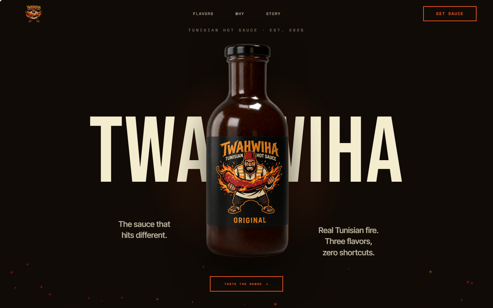

# TWAHWIHA

[](https://twahwiha.vercel.app)
[](https://github.com/FARUKxKUN/twahwiha/actions/workflows/ci.yml)


Scroll-driven showcase site for TWAHWIHA, a fictional Tunisian hot sauce brand.

**Live:** [twahwiha.vercel.app](https://twahwiha.vercel.app)



## Features

- Hero bottle that rotates and shifts with scroll, with parallax on the wordmark
- Pinned horizontal section that scrubs through the three flavors
- Background color that changes per section as you scroll
- Fire-trail cursor and floating ember particles
- Marquee that reacts to scroll velocity
- Magnetic buttons
- Smooth scroll with Lenis, synced to GSAP ScrollTrigger
- Every effect checks `prefers-reduced-motion`, and cursor effects turn off on touch devices

## Stack

- Next.js 16 (App Router), React 19, TypeScript
- Tailwind CSS v4
- GSAP + ScrollTrigger
- Lenis
- Bebas Neue, Inter Tight and Space Mono via `next/font`

## Structure

```
src/components/sections/   Hero, Story, Flavors, WhyDifferent, GetYours, Finale, Footer
src/components/effects/    FireCursor, Embers, VelocityMarquee, Magnetic, Reveal
src/lib/                   animations.ts, lenis.tsx
```

## Run locally

```bash
npm install
npm run dev
```

Open http://localhost:3000.

## My role

Solo project: concept, design and development.

## License

No license is granted. All rights reserved by Farouk Battikh.
